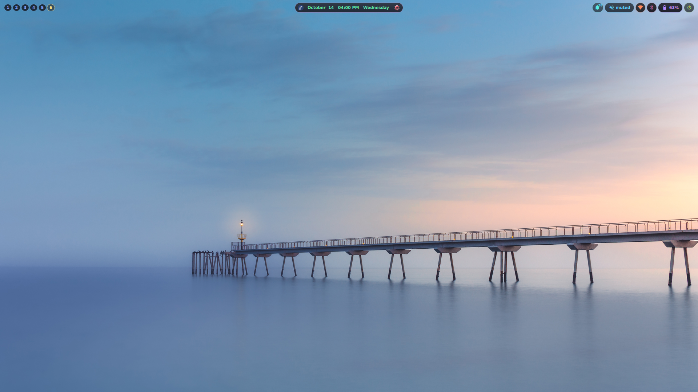
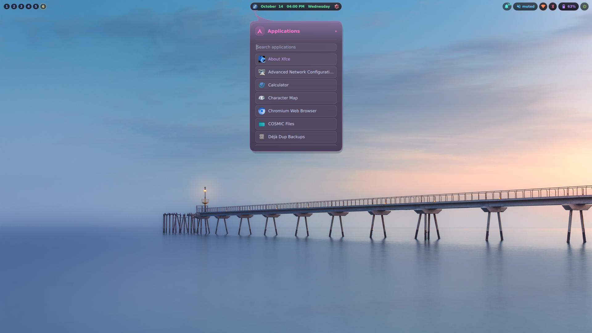
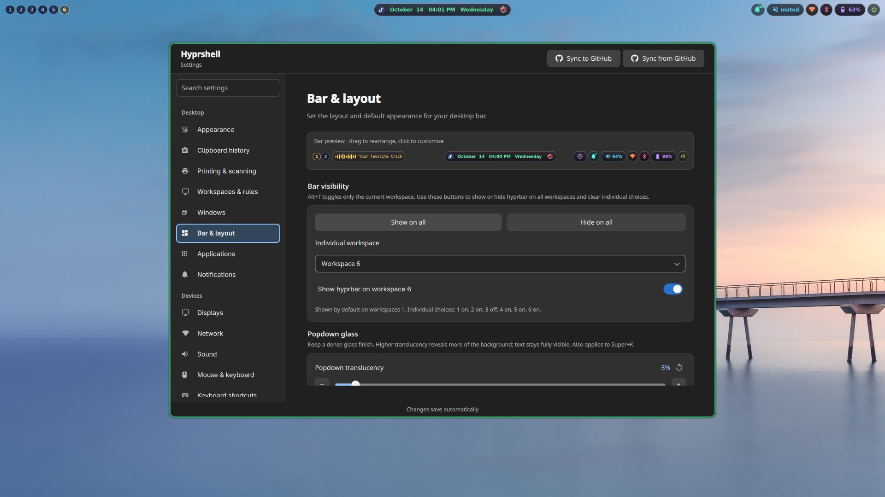
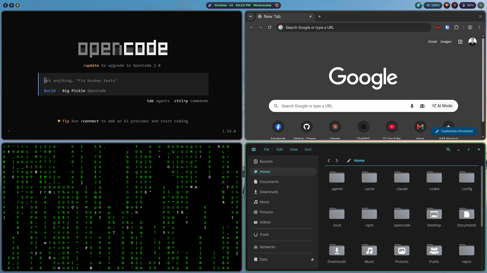
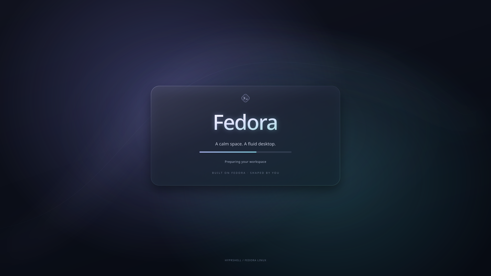

# Hyprshell

Hyprshell is a configurable desktop shell for **Hyprland on Arch Linux and Fedora**, built
with **Quickshell**. It brings the application launcher, status bar, desktop
menus, notification inbox, and settings into one native Qt 6 interface.

**hyprbar** is the name of Hyprshell's top bar. References to the “bar”,
“top bar”, or “topbar” in this documentation mean hyprbar.

The goal is a consistent desktop experience from boot and login through daily
use, with a lightweight foundation that gives beauty and performance equal
priority. Hyprshell builds on Hyprland and native Qt 6 components, brings
desktop controls into a shared shell, and keeps additional applications
optional. Development should favor efficient rendering, responsive controls,
and minimal background work as the desktop grows.

The bar uses translucent glass surfaces that adapt to the wallpaper beneath
each item. Its layout and appearance can be changed through a graphical
settings window, including the position of modules and selected Hyprland
appearance options.

This repository includes the shell, a Hyprland configuration, an Arch/Fedora
installer, desktop utilities, and wallpapers. Together they provide a common
desktop setup that users can install and customize through the same workflow.
It installs onto an existing system; it does not install the operating
system, partition disks, or install a bootloader. It installs common firmware, CPU
microcode, and Mesa graphics drivers; vendor-specific drivers still need review. It can
configure the animated Hyprshell Glass splash for a supported existing boot setup.
Full setup also installs the matching animated SDDM login theme. Fresh installs
use the author’s personal configuration; existing user preferences are retained.

The **Fedora setup** has separate package manifests, DNF-backed
Settings controls, and dracut boot splash support. See [Fedora installation
and validation](docs/fedora.md) for installation on Workstation, desktop Spins,
Server, or Everything, the default COPR and opt-out, and current validation limits. See [daily-driver setup](docs/daily-driver.md)
for system services, firmware, application defaults, and hardware checks. The instructions below
describe the established Arch installation unless stated otherwise.

## Contents

- [Screenshots](#screenshots)
- [Features](#features)
- [Requirements](#requirements)
- [Installation](#installation)
- [Installing alongside an existing desktop](#installing-alongside-an-existing-desktop)
- [Fedora installation](docs/fedora.md)
- [A consistent desktop experience](#a-consistent-desktop-experience)
- [First login and machine-specific configuration](#first-login-and-machine-specific-configuration)
- [Using the desktop](#using-the-desktop)
- [Keyboard and mouse shortcuts](#keyboard-and-mouse-shortcuts)
- [Customizing Hyprshell](#customizing-hyprshell)
- [Screen locking](#screen-locking)
- [System cleanup](#system-cleanup)
- [Saving your setup to GitHub](#saving-your-setup-to-github)
- [Updating, backups, and restoring files](#updating-backups-and-restoring-files)
- [Troubleshooting](#troubleshooting)
- [Project structure and development](#project-structure-and-development)

## Screenshots

<!-- desktop-screenshots:start -->
Captured from a running Hyprshell desktop.

### Hyprshell desktop and hyprbar



### Hyprshell application launcher



### Hyprshell desktop settings



### Hyprshell tiled windows


<!-- desktop-screenshots:end -->

To capture the running desktop, launcher, settings, and tiled windows, run
`python3 tools/capture_desktop.py` from a terminal in your Hyprland session.
The helper gives you time to arrange each view, asks you to review the images,
then saves them in `docs/assets/` and updates this gallery.
To add or refresh only the tiled windows view, use
`python3 tools/capture_desktop.py --view tiled`; existing screenshots are retained.

## Features

| Component | What it provides |
| --- | --- |
| Boot appearance | Animated Hyprshell Glass Plymouth splash, plus matching static artwork for supported unified kernel images. |
| Login screen | Matching animated Glass SDDM theme with user, password, session, keyboard layout, and power controls. |
| Application launcher | Search installed desktop applications and launch them from the bar or Super key. |
| Workspace controls | Switch between Hyprland workspaces. |
| Media display | Playback information and a twelve-band audio spectrum captured from speaker output. |
| Calendar | Date and time with a calendar menu; bundled holiday data covers the Philippines. |
| Notifications | Persistent inbox with search, expansion, dismissal, and clearing; optional popups configured in Settings. |
| Audio controls | Output and microphone volume, mute controls, and output selection. |
| Wi-Fi | NetworkManager integration for wireless connections. |
| Bluetooth | BlueZ integration with device controls and pairing prompts. |
| Battery | Charge and health information when available from the hardware. |
| System tray | Application-provided tray icons. |
| Power menu | Lock, sleep, logout, reboot, and shutdown actions. |
| Settings | A live bar preview, drag-to-reorder modules, desktop and application appearance, displays, input, power, default apps, login startup, and a shortcut editor. |
| Shortcut overlay | Search active Hyprland shortcuts with `Super+K`. |
| Optional management tools | Screen locking, scheduled file cleanup, and GitHub configuration sync. |

The interface and service bindings use QML and JavaScript. A small C helper
captures and analyzes audio for the spectrum; Python helpers handle settings
validation, installation, cleanup, and GitHub sync.

The installer disables NetworkManager's separate `nm-applet` tray icon with a
user autostart override in `config/autostart/nm-applet.desktop`. Hyprshell's
Wi-Fi menu uses NetworkManager directly. Other apps' autostart entries are
preserved.

Desktop configuration and its installation steps live together in this
repository. `setup.sh` installs the shell, themes and utilities, initializing
preferences only for new users. See [reviewed updates and profiles](docs/updates.md).

## Requirements

The supported installation targets and requirements are:

- An installed **x86_64 Arch Linux** or **traditional DNF-based Fedora 44** system.
  Fedora Workstation, desktop Spins, Server, and Everything use the same Fedora
  setup; Everything is not required.
- A normal user account with `sudo` access.
- Internet access and working package repositories for your distribution.
- **Hyprland 0.56 or newer**, using its Lua configuration API.
- Hyprland GUI utilities (`hyprland-guiutils`), installed by the setup script
  if missing.
- Quickshell 0.3.2+, UWSM 0.27.0+ and Qt 6, installed if missing.
- See [compatibility.json](compatibility.json) for supported systems, minimums
  and recorded baseline versions; newer versions are not automatically certified.
- Graphics drivers suitable for Hyprland.

The installer uses official Arch repositories and pacman on Arch, and DNF on
traditional DNF-based Fedora 44, regardless of edition or desktop Spin. Both
targets use x86_64.

Some modules depend on hardware: Bluetooth needs a supported adapter, battery
information needs a battery exposed by the system, and brightness controls need
a controllable backlight. Media information depends on application support.

## Installation

### 1. Get the repository

Install the checkout tools as your normal desktop user. On Arch Linux:

```bash
sudo pacman -Syu --needed git python
```

On Fedora:

```bash
sudo dnf install git python3 sudo
```

Then clone the repository on either distribution:

```bash
git clone https://github.com/orapagier/hyprshell.git
cd hyprshell
```

Keep this checkout after installation. You use it for updates, and the
installer records its location for GitHub sync.

### 2. Review the installation plan

```bash
./setup.sh --dry-run
```

The preview reports detected hardware, selected drivers, missing installed packages,
installation destinations, services, and timezone behavior without changing files
or installing packages. Python 3 is required for the read-only hardware checks. It does not
resolve remote package availability; full installation does. Review
the machine-specific defaults described below before using the supplied
Hyprland configuration.

### 3. Install the desktop

```bash
./setup.sh
```

Do not run the script with `sudo`. Run it as your normal user; it invokes sudo
for system operations when needed.

The installer:

1. Checks the operating system, architecture, CPU, PCI/USB hardware and installed
   packages, then selects the distro manifest and suitable hardware dependencies.
   Preserves the existing login manager, including SDDM in the package transaction
   only when no manager is installed.
2. Upgrades the system and installs desktop, daily-driver and firmware packages.
   Fedora first resolves/downloads the full transaction from compatible repositories.
3. Stages and validates desktop files, builds the audio helper, retains current
   preferences, and backs up changed managed files before deployment.
4. Enables networking, Bluetooth, user audio and graphical login; starts UPower.
5. Prepares printing/discovery, keyring login, time sync, firewall and SSD trim,
   preserving configured time-service/firewall alternatives.
6. Checks the native runtime, QML components and Hyprland configuration, then
   refreshes fonts and user directories.
7. Restores the Glass SDDM theme where applicable and the boot splash on supported
   existing layouts. Unsupported boot layouts retain their current appearance;
   actual initramfs rebuild failures stop setup.
8. Saves a redacted readiness report and provides the command for hardware checks
   after reboot/login.

### Whole-system planning

`setup.sh` builds one read-only [system plan](tools/system_plan.py) before any
sudo operation. `--dry-run` shows installed/missing dependencies for every
subsystem, plus the choices to install, preserve or review. Fedora reads installed
RPM packages and provider capabilities in one query; Arch checks dependency
providers with pacman. The package and service stages consume the same plan.

| Subsystem | What setup checks and decides |
| --- | --- |
| Session, portals and native libraries | Keep Hyprshell's required runtime and build dependencies; install missing providers and validate supported versions |
| CPU, graphics, audio and wireless firmware | Detect hardware and choose matching firmware/microcode/video packages; preserve custom kernels and proprietary drivers |
| Networking and audio services | Use NetworkManager and PipeWire/WirePlumber; stop before privileged changes if an exclusive network manager or legacy PulseAudio needs migration |
| Power and battery | Preserve configured or installed tuned, PPD, TLP, auto-cpufreq or System76 policies; use the distro default only when no existing power provider is found |
| Bluetooth and brightness | Detect adapters/backlights; retain hotplug tools, start Bluetooth only when an adapter is detected |
| Storage, time sync and firewall | Enable trim only for detected discard support; keep existing trim policy otherwise; preserve configured time/firewall alternatives and rules |
| Login, boot and security | Keep the login manager, bootloader, encryption options and authentication stack; install SDDM only if missing and honor appearance opt-outs |
| Apps, file integration, fonts and utilities | Use the shared desktop configuration and saved user choices; keep existing desktops and install the dependencies needed for those desktop functions |
| Printing, scanning and backups | Retain tools for local/network/hotplug peripherals; CUPS is socket-activated; backup schedules and clipboard capture remain opt-in |

This is dependency and compatibility planning across the whole installer.
Browser, file manager and font choices follow the desktop configuration and
saved preferences. Optional tools start according to their saved startup choices.
Conflicting backends stop installation for deliberate migration, preserving the
existing network, desktop and audio/power policies. See [TLP's guidance on competing power daemons](https://linrunner.de/tlp/faq/conflicts.html).

Inaccessible system-service/package checks are shown as unavailable and full
setup must be rerun from a normal system session. A TTY without a user D-Bus
session remains supported: installed audio packages are checked and user audio
services are enabled for the next login. Config-only updates skip system planning.

### Arch and Fedora feature parity

Both distributions install the same desktop payload and provide the same
Hyprshell features. Package names and system integration follow each distribution:

| Feature | Arch Linux | Fedora |
| --- | --- | --- |
| Bar, launcher, Settings, notifications, shortcuts, lock and wallpapers | Shared Hyprland/Quickshell configuration | Same configuration |
| Apps, printing/scanning, keyring, backups, clipboard tools and GitHub sync | Shared app selection and service planning | Same selection and planning |
| Firmware, microcode and GPU acceleration | Hardware-selected Arch packages, Mesa and FFmpeg | Hardware-selected Fedora packages and RPM Fusion codecs |
| Power profiles | power-profiles-daemon by default; preserve existing providers | tuned-ppd by default; preserve existing providers |
| Package management in setup and Settings | pacman | DNF |
| Glass login and boot appearance | SDDM and Plymouth with supported mkinitcpio layouts | SDDM and Plymouth with supported dracut layouts |
| Optional containers and terminal decoration | `--extra`: Distrobox, Podman, cmatrix | Same optional tools |

Both preserve existing desktops, login managers and user preferences, check
Hyprland compatibility before deploying configs, and verify H.264/HEVC software
decoders after full package setup. Boot layouts, proprietary drivers and actual
hardware behavior still need the checks described below; shared features do not
imply that every machine or desktop combination has completed acceptance testing.

### Hardware-aware packages and media support

Full setup includes media codecs and chooses acceleration packages from the
detected GPU, independently of the CPU vendor. It supports desktops, laptops
and hybrid graphics, selecting drivers for each machine.
[Hardware selection](tools/hardware_plan.py) reads kernel PCI/USB data
without collecting serial numbers, network names or device addresses.

| Detected hardware | Automatic selection |
| --- | --- |
| Intel CPU / AMD CPU | Matching microcode package; virtual CPUs leave microcode to the host |
| Known Broadwell-or-newer Intel GPU families | Intel iHD media driver; Intel Vulkan on Arch |
| Known older Intel GPU families | Legacy i965 media driver; software fallback for unsupported codecs |
| AMD GPU | Mesa graphics; Radeon Vulkan on Arch, Freeworld Mesa VA-API on Fedora |
| NVIDIA GPU | Preserve the current driver; Nouveau Vulkan on Arch only when Nouveau is detected; report proprietary-driver/Secure Boot review |
| Other, virtual or unidentified GPU | Keep Mesa and software codecs; report that acceleration needs review |

The general firmware package remains installed. Fedora's split firmware packages
are selected by detected PCI/USB vendors, with SOF firmware for Intel audio.
If the inventory is inaccessible, setup retains broad firmware coverage and reports
the limitation. Fedora kernel modules are selected for a detected Fedora kernel;
custom kernels retain their existing module setup and receive a review note.
Existing configured time-sync/firewall alternatives and an installed full Fedora
FFmpeg are preserved.

Fedora setup enables RPM Fusion free/nonfree, installs `libavcodec-freeworld`
**alongside** Fedora's codec package, and resolves selected media-driver
transactions before the system upgrade. Only conflicting Intel/Mesa acceleration
counterparts are swapped. Arch uses its distribution FFmpeg and GPU packages.
mpv defaults to `hwdec=auto-safe`, with software fallback. Both H.264 and HEVC
software decoders are checked during full setup on both distributions.

Installed packages/providers are checked first. Arch uses `--needed` with a full
system upgrade; Fedora rechecks after upgrading and installs missing dependencies.
Rerunning setup does not force reinstall already satisfied packages or remove
drivers belonging to other hardware. `--config-only` and `--update` skip package
and hardware selection. Full setup still upgrades the system even when every
desktop package is present.

Automatic selection follows supported driver families, not a universal performance
ranking. New/unknown GPU IDs, proprietary NVIDIA branches, Secure Boot, vendor
Wi-Fi drivers and printer drivers need review. Package installation does not prove
hardware decoding or suspend works: run `vainfo` in the desktop session and check
actual mpv/browser playback. See [Fedora's acceleration guidance](https://fedoraproject.org/wiki/Hardware_Video_Acceleration)
and [daily-driver checks](docs/daily-driver.md).

The base package list is in [packages.txt](packages.txt). It includes Chromium,
Kitty, COSMIC Files with GVfs/MTP support (`gvfs-mtp`), UWSM, portals,
the Polkit agent, fonts and icons, screenshot and
brightness tools, NetworkManager, BlueZ, UPower, PipeWire, and WirePlumber.
It also includes Plymouth. See [boot splash setup and portability](docs/boot-splash.md)
for supported UKI, GRUB, and systemd-boot layouts and boot configuration backups.
The static UKI splash replaces the embedded Arch logo; systemd-boot's text menu
stays unchanged. See [login appearance](docs/login-appearance.md) for the matching
SDDM theme and a combined installer for an already configured machine.

Changed shared files are backed up. Conflicting local code edits stop deployment;
current preferences and unrelated files are retained. See [updates](docs/updates.md).
The installer preserves your timezone and existing login manager. If no login
manager is configured or detected as an installed service, it installs SDDM,
enables it for the next boot, and selects the graphical boot target.
It does not reboot the machine or restart the running desktop.

### Installing alongside an existing desktop

Hyprshell is designed to coexist with an existing desktop, including KDE
Plasma, GNOME, Xfce, Cinnamon, MATE, LXQt, or COSMIC, on a supported system.
The installer preserves existing desktops, their sessions and the login manager,
and installs SDDM only when none is found. At a login screen that supports Hyprland,
select **Hyprland (uwsm-managed)** to use Hyprshell, or select your existing
desktop to return to it. Log out before switching sessions. Hyprshell's bar,
launcher, and desktop controls run in the Hyprland session.

The installation limits remain x86_64 Arch Linux and traditional DNF-based
Fedora 44 across its DNF-based editions and Spins. Hyprshell can be installed
alongside any existing desktop environment; it runs as a separate Hyprland session.
Preservation of existing desktops is confirmed by installer/configuration
review; fresh coexistence tests for the desktops listed above are pending.
Identical behavior across desktops and hardware is not yet certified;
see [compatibility.json](compatibility.json) and [Fedora validation](docs/fedora.md).
Fedora Kinoite, Silverblue, and other Atomic/OSTree systems are unsupported.

Preserving a login manager does not guarantee that its greeter can list or
launch the Hyprland session. Check the upstream [Hyprland launch guidance](https://wiki.hypr.land/getting-started/master-tutorial/#launching-hyprland)
for current manager-specific limitations. If it cannot launch Hyprland, use the
TTY command under [Start a session](#4-start-a-session). The installer does not
replace that manager automatically to resolve launch compatibility. The Glass
login theme is applied only to SDDM; other login managers retain their appearance.

Full setup upgrades system packages, enables shared services, and applies the
SDDM theme and supported boot splash by default. To keep the existing login
and boot appearance, preview and install with:

```bash
./setup.sh --dry-run --skip-login-theme --skip-boot-splash
./setup.sh --skip-login-theme --skip-boot-splash
```

Some user preferences are shared across desktop sessions. A fresh Hyprshell
installation restores bundled default-app choices in `mimeapps.list` and can
update an existing desktop-specific defaults file for the desktop running the
installer. The managed `nm-applet.desktop` autostart override hides that applet
across sessions. These appearance flags do not prevent shared preference or
service changes; review application defaults and startup choices after setup.
In desktops that rely on `nm-applet` for their network tray, that override also
hides their network icon. Hyprshell's network menu is available only in its own
session.

### Boot and login appearance

The startup sequence uses a shared dark glass design with lavender/cyan
lighting and Hyprshell lettering. On a supported UKI installation, a static
matching image appears before Plymouth animates the title, glow, and boot
progress. SDDM then shows the animated login card. Plymouth also supplies
password prompts and shutdown artwork.




Firmware logos and the existing bootloader menu remain machine-specific.
Plymouth and SDDM have separate animation clocks; graphics initialization can
cause a brief blank frame between them. Check the sequence after reboot on
each machine. The detailed [boot](docs/boot-splash.md) and
[login](docs/login-appearance.md) guides include previews, separate installers,
supported layouts, and recovery instructions.

### Installation options

| Option | Purpose |
| --- | --- |
| `--dry-run` | Preview the plan without making changes. |
| `--config-only` | Install configurations, utilities, and wallpapers, and compile the spectrum helper; skip package and service changes. |
| `--extra` | Also install Distrobox, Podman, and cmatrix from the optional distro manifest. |
| `--no-copr` | On Fedora, use only enabled repositories instead of enabling the default desktop COPR. |
| `--skip-boot-splash` | Leave system boot configuration unchanged. |
| `--skip-login-theme` | Leave the current login screen appearance unchanged. |
| `--timezone ZONE` | Set an explicit timezone, such as `Europe/London`. |
| `--keep-timezone` | Preserve the current timezone; this is the default. |
| `--help` | Show command-line help. |

Examples:

```bash
./setup.sh --extra --dry-run
./setup.sh --extra
./setup.sh --timezone Europe/London
```

Setup also installs Bash shortcuts while preserving your existing `~/.bashrc`:
`pcm package-name` runs `sudo pacman -S --needed package-name`; `fedora` and
`ubuntu` enter the matching Distroboxes. Other existing container names become
commands when you open a terminal, provided they do not conflict with an existing
command. After creating a container, run `hyprshell_refresh_boxes` or open a new
terminal. To load the shortcuts in an already open terminal, run `source ~/.bashrc`.
These shortcuts are also installed by `--config-only`.

The main setup and `--config-only` install Kitty's one-handed clipboard defaults:
Ctrl+V pastes text through Kitty, or forwards the key to the terminal application
when the clipboard offers an image so apps can attach it themselves.
Ctrl+C copies selected text or interrupts the running command
when nothing is selected. Editors retain their native Ctrl+C/V/X shortcuts.
Super+C/V clipboard forwarding is omitted to avoid stuck synthetic keys.
Tab completion remains available. Bash's default Emacs editing shortcuts remain
Ctrl+U to remove text before the cursor, Ctrl+K to remove text after it, and
Ctrl+Y to restore removed text; these use Bash's own buffer, not the desktop
clipboard. Terminal output can be copied, but cannot be cut.

The main install includes Hyprlock, XDG utilities and clipboard tools,
Loupe, Papers, mpv, File Roller, rsync, htop, Déjà Dup, Restic, rclone,
and yt-dlp, plus Mousepad, media controls, archives, clipboard-history tools,
printing/scanning, firmware, keyring support, time synchronization and firewall.
This checkout enables Hyprlock after 60 idle minutes and before sleep.
Clipboard capture stays disabled until enabled in Settings. Backup destinations
and schedules need to be configured after installation.

The optional [application list](packages-apps.txt) includes Distrobox, Podman,
and cmatrix. Everyday applications are included in the base installation.

`--config-only` requires Python 3, a C compiler, and the libpulse/FFTW development
files to be installed already. Use the full installer when dependencies are
missing.

### 4. Start a session

After installation, reboot and select **Hyprland (uwsm-managed)** in your login
screen. If you do not use a display manager, log in on a TTY and run:

```bash
uwsm start -e -D Hyprland hyprland.desktop
```

Use `Super+T` to open a terminal and press and release `Super` to open the
application launcher. The Windows key is normally the Super key.

## A consistent desktop experience

Full `./setup.sh` brings the bundled boot appearance, matching SDDM login
theme, and Hyprshell desktop together on an installed Arch system. The
configuration in the checkout defines the experience, so each installation
starts with the same shell components, visual design, and desktop preferences.

| Component | Included setup |
| --- | --- |
| Boot splash | Plymouth Glass artwork, animated title and progress, quiet-boot preferences, and matching static UKI artwork on supported boot layouts. |
| Login screen | Animated `hyprshell-glass` SDDM theme with the same visual language as the boot splash and desktop. |
| Desktop shell | Quickshell bar, launcher, menus, notification inbox, settings, and wallpaper-adaptive glass surfaces. |
| Desktop preferences | Saved layout and appearance, Hyprland configuration, shortcuts, display settings when saved, input, power, locking, and cleanup preferences. |
| Application integration | Saved application appearance, default-app and login-startup choices, portals, and managed autostart entries. |
| Utilities and wallpapers | Launch helpers, Bash shortcuts, application shortcuts, and bundled wallpapers. |

Use `./setup.sh` for the desktop and everyday applications. Add `--extra` for
containers and terminal decoration. After installation, Settings lets users adjust
the experience through the same interface, while the configuration and
installer remain available for further customization.

## First login and machine-specific configuration

The supplied configuration is a starting point. Review these defaults for your
own hardware and preferences:

| Setting | Where to change it |
| --- | --- |
| Display resolution, refresh rate, scale, and position | Settings → Displays; underlying rules in `~/.config/hyprshell/hyprland/monitors.lua` and `hypr/hyprland-gui.lua`. |
| Keyboard layout | The `input.kb_layout` value in `~/.config/hyprshell/hyprland/input.lua`; bundled value is `us`. |
| Terminal and file manager | The `terminal` and `fileManager` entries in `~/.config/hyprshell/hyprland/programs.lua`. |
| Browser shortcut | The `Super+B` default binding in `hyprshell/hyprland/shortcuts.lua`; it launches Chromium, which the base installer provides. |
| Startup wallpaper | `~/.config/hypr/wallpaper-start.sh`. |
| Clock display | Hyprshell Settings → Bar & layout. |
| Holiday data | `~/.config/quickshell/Calendar.js`. |

The main configuration has an automatic preferred-mode monitor rule, but
`hyprland-gui.lua` also contains an explicit **`eDP-1`, 1920×1080 at 60.01 Hz,
scale 1** rule. Update or remove that rule if it does not match your display.
Inspect connected outputs inside Hyprland with:

```bash
hyprctl monitors
```

After editing your installed Hyprland configuration, validate and reload it:

```bash
Hyprland --verify-config --config "${XDG_CONFIG_HOME:-$HOME/.config}/hypr/hyprland.lua"
hyprctl reload
```

Hyprshell installs the saved preferences in `config/hyprshell/settings.json`
when that file exists in the checkout. These can differ from the bundled
component defaults. Review the Settings window after your first login.

## Using the desktop

### Bar and menus

Hover over a menu icon to open its menu, then move into the menu to interact
with it. Hovering another icon switches menus. Click an icon to pin its menu
open; another click, an outside click, or Escape closes it.

Menus follow their icons when you move or reorder modules, and stay within
screen edges. Some items appear only when relevant, such as the battery on
supported hardware or media information during playback.

### Applications and workspaces

Press and release Super, or click the launcher logo, to open the application
launcher. Type to filter applications by name and select an entry to launch it.
Applications are discovered through installed desktop entries.

Use workspace buttons or `Super+1` through `Super+0` to switch workspaces.
Hold Shift with those shortcuts to move the focused window to a workspace.
Regular application windows tile; the supplied rules float common dialogs and
file choosers.

### Audio, networking, and Bluetooth

The audio menu provides volume and microphone sliders, mute controls, and
output selection. Sliders support clicking and dragging. The visualizer
captures the **speaker output monitor**, not microphone input.

The Wi-Fi menu uses NetworkManager. The Bluetooth menu uses BlueZ and handles
pairing prompts in the interface. Their availability depends on the relevant
services, hardware, and radio state.

### Notifications

Notifications appear in the bell's inbox without toast popups. Click a
notification to expand its full title and body, scroll to read long messages,
and use its corner × to dismiss it. Search and Clear all are available.

History is stored through Quickshell at `Quickshell.statePath("notifications.json")`.
An older notification database, if present, can be imported once using read-only
SQLite access. Hyprshell preserves the message text supplied by applications;
it cannot recover text an application truncated before sending.

### Wallpapers

Put JPG, JPEG, PNG, or WebP images in `~/Pictures/Wallpapers`. Use `Super+W` for
the next wallpaper and `Super+Shift+W` for the previous one. The cycling script
uses a sorted list of files in that directory.

The supplied startup script selects `default.jpg` on login. Edit
`wallpaper-start.sh` to choose a different startup image. Wallpaper rendering
uses `awww`; bar colors adapt to the wallpaper on each output.

## Keyboard and mouse shortcuts

These shortcuts belong to the bundled Hyprland configuration. Changing your
keybindings changes the behavior described here.

| Shortcut | Action |
| --- | --- |
| `Super+T` | Open Kitty. |
| Press and release `Super` | Toggle the application launcher. |
| `Super+E` | Open a COSMIC Files window. |
| `Super+K` | Toggle the searchable shortcut overlay. |
| `Alt+T` | Show or hide the topbar. |
| `Alt+S` | Open Hyprshell Settings. |
| `Alt+C` / `Alt+N` | Toggle calendar / notifications. |
| `Alt+A` / `Alt+W` | Toggle audio / Wi-Fi. |
| `Alt+V` / `Alt+B` / `Alt+P` | Toggle Bluetooth / battery / power options. |
| `Super+B` | Launch Chromium (the default browser); customize this binding for another browser. |
| `Super+Q` | Close the focused window. |
| `Super+M` | Toggle maximized mode. |
| `Super+V` | Toggle floating mode. |
| `Super+Arrow keys` | Move focus between windows. |
| `Super+1…9`, `Super+0` | Switch to workspace 1…10. |
| `Super+Shift+1…9`, `Super+Shift+0` | Move the focused window to workspace 1…10. |
| `Super+Mouse wheel` | Switch to the next or previous workspace. |
| `Super+Left drag` | Move a window. |
| `Super+Right drag` | Resize a window. |
| `Super+P` | Toggle pseudotiling. |
| `Super+J` | Toggle the split direction in the dwindle layout. |
| `Super+S` | Toggle the `magic` special workspace. |
| `Super+Shift+S` | Move the focused window to that special workspace. |
| `Super+H` / `Super+Shift+H` | Hide / restore a window. |
| `Super+W` / `Super+Shift+W` | Next / previous wallpaper. |
| `Print` or `Insert` | Select a screenshot region and open it in Swappy. |
| `F2` / `F3` | Lower / raise output volume. |
| `F4` / `F1` | Toggle output / microphone mute. |
| `F6` / `F7` | Lower / raise brightness. |
| Supported media and brightness keys | Control volume, playback, microphone mute, or brightness. |
| `Super+Shift+M` | End the Hyprland session. |

The saved shortcut customizations in this checkout also bind `Alt+Q` to reload
Hyprshell. Use `Super+K` to inspect active shortcuts after customizations. The
Alt menu shortcuts work while the topbar is hidden.

Playback keybindings use `playerctl`, included in the base installation. Brightness bindings depend on the system's backlight
support.

## Customizing Hyprshell

### Open Settings

Open **Hyprshell Settings** in the application launcher, or use the cog menu
on the bar and select **Open Hyprshell Settings**. From a terminal:

```bash
~/.local/bin/hyprshell-settings
```

The bar must be running. Settings opens inside the existing Quickshell process
and includes a preview with sample statuses. The preview's colors and visible
sample modules may differ from live hardware and wallpaper colors.

### Layout and appearance

Use the preview to select an item or drag it into the left, center, or right
group. You can reorder items, show or hide built-in modules, and adjust:

- Bar height, margins, spacing, and clock format.
- Global and individual icon sizes from 8–48 px.
- Per-item text and icon glyphs, font size, and extra spacing.
- Text, icon, background, and outline colors using `#RRGGBB`.
- Item opacity, background opacity, pill visibility, and corner radius.
- Wallpaper-adaptive colors globally or per item.
- Random vibrant item colors that reshuffle when the wallpaper changes.

Individual overrides take priority over general settings. Choose inheritance
or use the relevant reset control to return to the general value. Manual colors
override the corresponding adaptive colors. Tray artwork remains supplied by
its application.

Avoid overcrowding the bar: unusually wide labels or too many center items can
overlap other groups. Shorten text, reduce sizes, hide items, or move them to
another group. Status services continue running when their bar items are hidden.

### Saving and Hyprland appearance

Most bar, appearance, and locking preferences save automatically after a short
pause. Closing Settings flushes pending changes. Invalid values show an error
and leave the last saved configuration active; correct the value to resume
saving. System cleanup and keybinding edits have their own explicit save actions.

Preferences live in:

```text
~/.config/hyprshell/settings.json
```

The Hyprland appearance page controls selected options such as gaps, borders,
rounding, opacity, blur, shadows, and animations. Empty or “Use config” values
leave that option controlled by your underlying Hyprland configuration.

Explicit overrides are written to `hyprshell/overrides.lua` for the supplied
Lua configuration. The settings backend also supports traditional `.conf`
main configurations. Changes are validated and backed up; a failed Hyprland
reload rolls back affected files.

Settings → Displays manages connected outputs and saves confirmed choices in
`hyprshell/displays.json` and generated `displays.lua`. New outputs follow the
automatic monitor rule. Arbitrary third-party Quickshell components and
Hyprland options outside the available settings still require editing the
appropriate configuration files. See
[the settings reference](docs/settings.md) for detailed behavior and extension
points.

### Editing shortcuts

Open **Settings → Keybindings** to search active shortcuts, select one to edit,
or choose **+ New**. Record a key combination or enter it manually, add an
action description, and keep the existing action or supply a command. Click
**Save shortcut** to apply it. **Restore** resets an edited built-in shortcut;
**Remove** deletes an added shortcut.

The editor checks conflicts, validates the Hyprland configuration, and reloads
it. Failed validation or application restores the previous files. Saved edits
live in `~/.config/hyprshell/keybindings.json`; `keybindings.lua` is generated
from them and applied after the base Lua configuration. The `Super+K` overlay
shows active bindings, including these edits.

## Screen locking

The component default for automatic locking is disabled, but this checkout's
saved preferences enable Hyprlock after 60 idle minutes and before sleep.
Setup restores those saved preferences and installs Hyprlock and Hypridle in
the base manifest. To repair missing packages on an existing Arch installation:

```bash
sudo pacman -Syu --needed hypridle hyprlock
```

Open **Settings → Screen locking**, choose your locker command, and test it
with **Lock now**. Then enable automatic locking, choose an idle timeout, and
optionally enable locking before sleep. A timeout of 0 disables the idle timer.

Configure Hyprlock's appearance in `~/.config/hypr/hyprlock.conf`, or use your
chosen locker's own configuration. Custom commands support quoted arguments
and `~` paths; they do not expand environment variables or execute shell
operators. The locker must remain in the foreground until unlocked.

Hyprshell manages its own Hypridle child while automatic locking is enabled.
Disable a separately configured Hypridle service or autostart before enabling
this feature; Settings reports conflicts. Automatic locking runs with the
shell, so it depends on Hyprshell continuing to run. Closing the Settings
window does not stop it.

## System cleanup

Open **Settings → System cleanup** to configure cleanup of old thumbnail cache
files, eligible temporary files owned by your user, and old Hyprshell backups.

Choose Off, Daily, Weekly, or Monthly, select categories, and click **Save
cleanup settings**. Scheduling starts Off. The default age limit is 30 days,
and the newest five backup sets are retained.

Use **Clean System Now…** to review eligible paths and sizes. **Delete previewed
files** confirms that specific cleanup. Scheduled runs use the saved rules
without prompting. Symlinks and active configurations are excluded, and
recently accessed or changed files are kept.

The schedule uses the systemd user timer `hyprshell-cleanup.timer`. Results are
recorded in `~/.local/state/hyprshell/cleanup-last.json` and the service journal.
Package-cache cleanup is separate; this page reports the existing system
`paccache.timer` rather than including package caches in the file preview.

## Saving your setup to GitHub

The **Sync to GitHub** button in Settings snapshots your live desktop, commits locally, then pushes
to a repository named `hyprshell` in your authenticated GitHub account.

1. Open the sync popup and choose **Authenticate**.
2. Complete GitHub CLI browser sign-in in the Kitty terminal.
3. Use a fork of this project or create a repository named `hyprshell` in your
   account. For an empty standalone repository, leave README, license, and
   `.gitignore` initialization unchecked.
4. Select **Check again** and verify the displayed account and target.
5. Start the sync and check its result.

There is one canonical configuration under `config/`, including personal preferences.
When you choose Sync to GitHub, it captures live `hypr/` and `quickshell/` code, editable
Hyprland sections, and saved `hyprshell/settings.json`, cleanup preferences,
shortcut and display customizations, application appearance, default apps,
and login-startup choices.
It also captures installed copies of files already managed by the checkout:
portal preferences, autostart overrides, utilities, application shortcuts, and
the bundled `default.jpg` wallpaper. Other wallpapers stay local and are ignored
by Git. Additional personal files in those locations are
not imported automatically. It also commits project files: configuration,
utilities, assets, tools, tests, documentation, workflows, package manifests,
the installer, and README. This keeps the installation guide and installer in
sync with the desktop. Tracked deletions in these paths are included.

Boot and SDDM artwork, preferences, and their installers are preserved as
repository files. Sync does not read back root-owned boot or login files;
preserve changes to those themes in `config/boot/` or `config/sddm/` and their
installers before syncing. Setup derives the new machine's boot configuration
locally rather than copying the old machine's disk identifiers or boot images.

Backups, logs, Python caches, and the compiled spectrum helper are excluded
from the live snapshot. Files outside the explicit project paths remain
uncommitted. Review project and custom configuration content before syncing
to a public repository.

Manual desktop edits remain live and uncommitted until you choose **Sync to GitHub**.
Agents commit successfully completed, validated tasks locally with meaningful
descriptions; questions and tasks needing follow-up do not trigger commits.
There is no background Git saver. Sync reconciles live and checkout changes,
validates them, creates a local commit if needed, then pushes. Existing commits
keep their original subjects and bodies, including completed agent task descriptions.
Sync creates a new commit only for remaining uncommitted edits, with a subject naming
the affected components and a body listing added, modified, and removed files.
A failed push leaves
the local commit for retry.
Staged changes, unfinished merges, or conflicting repo/live copies require
resolution before publishing. Configure a Git commit identity on fresh clones.

**Sync from GitHub** checks the developer’s `orapagier/hyprshell` repository on
`main`, even when the checkout tracks your fork. The window identifies this source
and previews updates without committing local edits. Conflicts show both full-file
versions and a diff, with **Keep your local version** and **Use developer’s version**
checkboxes, including deletions. Select one version per conflict, click **Review choices**, acknowledge
the updated review, then **Sync now**. Local edits kept during an update remain
uncommitted until Sync to GitHub. Updates can add a merge commit for already
committed branch history, without including your unsynced edits. Pushes never
force or automatically merge remote changes. **Sync to GitHub** continues publishing
to your own repository; checking for developer updates leaves that destination intact.

Setup records the checkout location in
`~/.local/state/hyprshell/repository`. Re-running setup updates that pointer.

## Updating, backups, and restoring files

### Updating

Use **Sync from GitHub**, to the right of **Sync to GitHub** in Settings. Review
incoming commits, files, package requirements and compatibility findings. Once
blocking issues are resolved, acknowledge the hardware limitations and click
**Sync now**. The preview shows the exact source repository and branch.

The update preserves preferences and original Git history, stages and validates
the candidate, and retains recovery files. Log out and back in after completion.
For an already updated local checkout, `./setup.sh --update` applies and validates
its desktop files without upgrading system packages. Use full setup when new
system dependencies or root-owned integration changes require it.

Fresh installations use the same committed configuration as this desktop.
Existing installations retain customized preferences. Fork the project to keep
your own taste and commits. See [updates, forks and recovery](docs/updates.md)
and the [fresh-install/hardware checklist](docs/acceptance.md).

### Backups and restoration

Deployment backups use `~/.local/state/hyprshell/backups/update-<timestamp>-<id>/`.
They contain changed files and a transaction journal, not whole configuration
directories or personal documents. Use the documented rollback command in
[updates.md](docs/updates.md#recovery); do not replace a complete configuration
directory with a partial deployment backup. Settings transactions retain their
own separate backup sets.

### Configuration and state paths

| Path | Purpose |
| --- | --- |
| `~/.config/hypr/` | Hyprland configuration, wallpaper scripts, and Hyprlock configuration. |
| `~/.config/quickshell/` | Installed shell components and helpers. |
| `~/.config/hyprshell/settings.json` | Saved Hyprshell preferences. |
| `~/.config/hyprshell/cleanup.json` | Saved cleanup rules and schedule. |
| `~/.config/hyprshell/keybindings.json` / `keybindings.lua` | Saved shortcut edits and generated Lua bindings. |
| `~/.config/autostart/nm-applet.desktop` | Managed override hiding the duplicate network tray icon. |
| `~/.config/hyprshell/overrides.lua` | Generated Hyprland appearance overrides for Lua configs. |
| `~/.config/hyprshell/hypridle.conf` | Generated idle configuration when managed by Hyprshell. |
| `~/.config/xdg-desktop-portal/` | Desktop portal preferences. |
| `~/.local/bin/` | Installed launcher, session, and settings utilities. |
| `~/.local/state/hyprshell/` | Repository pointer, configuration backups, and cleanup results. |
| `~/.local/state/quickshell/bar.log` | Session launcher output. |
| `~/Pictures/Wallpapers/` | Wallpaper images. |

These are default paths. The installer and settings helpers respect
`XDG_CONFIG_HOME` and `XDG_STATE_HOME`; use the corresponding custom locations
if you set them. Wallpaper storage remains under `~/Pictures/Wallpapers`.

## Troubleshooting

Run desktop commands inside your Hyprland session so they can access its
Wayland socket, Hyprland socket, and user D-Bus session.

### The bar does not start

Check the launcher output and try starting it again:

```bash
tail -n 100 "${XDG_STATE_HOME:-$HOME/.local/state}/quickshell/bar.log"
~/.local/bin/start-quickshell-bar
```

Check that Quickshell is installed, the installed `quickshell/shell.qml` exists,
and the configured startup command points to `start-quickshell-bar`. From the
repository, check native dependencies with:

```bash
python3 tools/check_runtime.py --native
```

The launcher verifies both bar readiness and notification ownership and reports
startup failures in the log.

### Settings or the application launcher will not open

Both communicate with the running Hyprshell instance. The application launcher
tries to start the bar if it is unavailable; Settings requires the bar to be
running. If utilities or the desktop entry are missing, reinstall with
`./setup.sh --config-only`. Applications missing from the launcher may lack
an installed desktop entry.

### An Android phone does not appear in Files

Android USB file transfer uses `gvfs-mtp`. It is included in
the base desktop setup; older installations may have installed it only with
`--extra`. To add it to an existing Arch installation, run:

```bash
sudo pacman -Syu --needed gvfs-mtp
```

Unlock the phone, select **File transfer / Android Auto** in its USB options,
and accept any file-access prompt. After installation, close COSMIC Files,
reconnect the phone, and open it again (`Super+E`). Check its network/volume
locations for the phone. If it remains absent, log out and back in to refresh
the session's GVfs volume monitors.

In a desktop terminal, `gio mount -li` shows detected volumes. If the phone is
still absent, check that the cable supports data and try another USB port.
The phone's storage is accessed through MTP, so it does not need a disk mount
or an `/etc/fstab` entry.

### Notifications are missing

Ensure another notification daemon is not already holding
`org.freedesktop.Notifications` in your user session. Disable a conflicting
daemon's service or autostart, then restart Hyprshell. Toast popups are not
expected; check the bell's inbox. You can send a test message with:

```bash
notify-send 'Hyprshell test' 'Check the notification inbox.'
```

### Audio, Wi-Fi, or Bluetooth controls are unavailable

Check their service status:

```bash
systemctl --user status pipewire pipewire-pulse wireplumber
systemctl status NetworkManager bluetooth
```

Also check hardware availability and radio state. No spectrum activity is
expected when the speaker output is silent. If compilation fails during
installation, check that GCC, libpulse, and FFTW are installed.

### Display, shortcuts, or icons do not look right

Review the explicit `eDP-1` monitor rule and keyboard layout described in the
first-login section. Change shortcuts that invoke applications you do not use.
Missing glyphs usually indicate missing fonts; install the manifest's fonts
and restart the session. If bar groups overlap, reduce item widths or move
modules between groups.

### A settings change will not save

Read the error in Settings. Correct invalid values, check file permissions,
and resolve any concurrent edits before retrying. Malformed JSON must be
repaired before saving. Failed Hyprland reloads restore affected files; validate
your main configuration before trying the change again.

### GitHub sync fails

Check the displayed account, repository name, push permissions, and network
access. Re-authenticate if sign-in expired. Commit or unstage existing staged
changes, and finish any merge or rebase. If your remote branch has diverged,
resolve it through your normal Git workflow; the sync tool never force-pushes.

### Automatic locking does not work

Use **Lock now** to test the saved locker command first. Check that Hypridle
and the locker are installed, another Hypridle process is not conflicting,
and Hyprshell is running. Review errors on the Screen locking page.

## Project structure and development

| Location | Contents |
| --- | --- |
| `config/quickshell/` | QML/JavaScript shell, service bindings, and settings helpers. |
| `config/hypr/` | Bundled Hyprland configuration and wallpaper scripts. |
| `config/hyprshell/` | Saved preferences installed with the desktop. |
| `config/boot/` | Saved Plymouth preferences, animated Glass theme, source artwork, and static UKI splash. |
| `config/sddm/hyprshell-glass/` | Matching animated Qt 6 login theme and artwork. |
| `config/autostart/` | Managed application autostart overrides. |
| `config/xdg-desktop-portal/` | Portal configuration. |
| `bin/` | Shell launcher, application launcher, and settings shortcut. |
| `assets/` | Wallpapers and application desktop entries. |
| `tools/` | Installer and runtime validation helpers. |
| `docs/boot-splash.md` / `docs/login-appearance.md` | Boot/login installation, previews, portability limits, and recovery. |
| `tests/` | Python tests for installation, settings, sync, locking, and cleanup. |
| `config/quickshell/tests/` | QML component tests and spectrum checks. |
| `packages.txt` / `packages-apps.txt` | Base desktop and optional application manifests. |

For component details, see the [Quickshell guide](config/quickshell/README.md).
For settings validation, inheritance, persistence, and extension points, see
[the settings implementation reference](docs/settings.md).

Run the relevant checks from the repository root with dependencies installed:

```bash
python3 -m unittest discover -s tests -v
Hyprland --verify-config --config "$PWD/config/hypr/hyprland.lua"
cc -O2 config/quickshell/helpers/audio-spectrum.c \
  -o config/quickshell/helpers/audio-spectrum -lpulse-simple -lpulse -lfftw3 -lm
QT_QPA_PLATFORM=offscreen QT_QUICK_BACKEND=software \
  /usr/lib/qt6/bin/qmltestrunner -input config/quickshell/tests
python3 config/quickshell/tests/test_spectrum.py
```

Python installer tests use isolated temporary home directories. QML tests cover
layout, menus, appearance, notifications, audio controls, and wallpaper sampling.
Spectrum tests check frequency separation and capture lifecycle. Full hardware
behavior still needs a real session with the relevant devices and services.

Bundled holiday rules may need updates for special government declarations.
Bundled wallpapers are third-party images; inclusion here does not grant new
ownership or licensing rights over them.

## Agent machine context

[Hyprskill](docs/hyprskill.md) gives Codex, Claude Code, and OpenCode reusable
context about this desktop from any working directory. Open **Settings →
Hyprskill → Install Hyprskill**, or install its global links with
`python3 tools/install_hyprskill.py`. Restart your agents afterward; desktop
installation stays separate.
